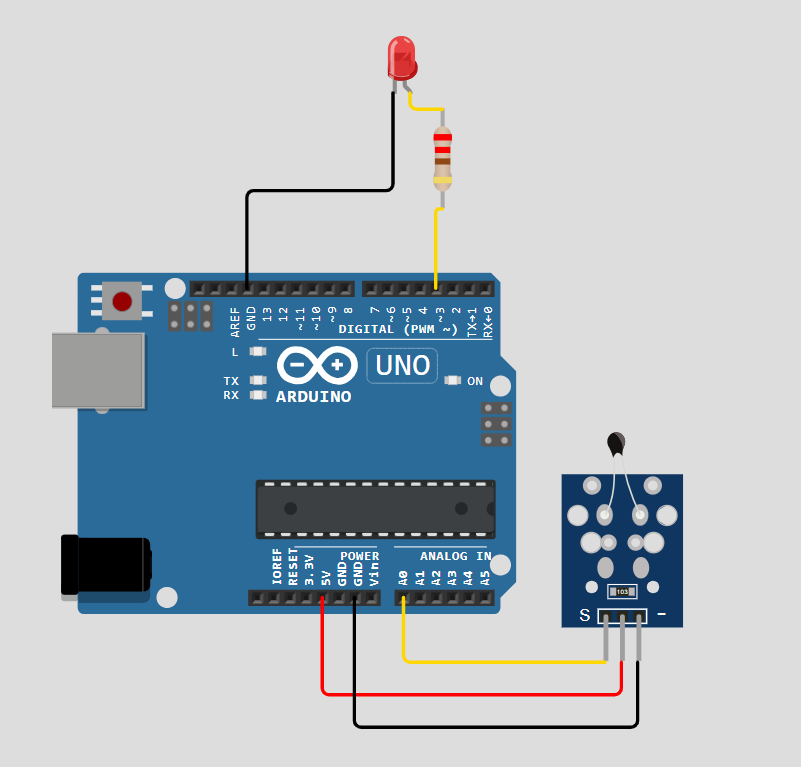
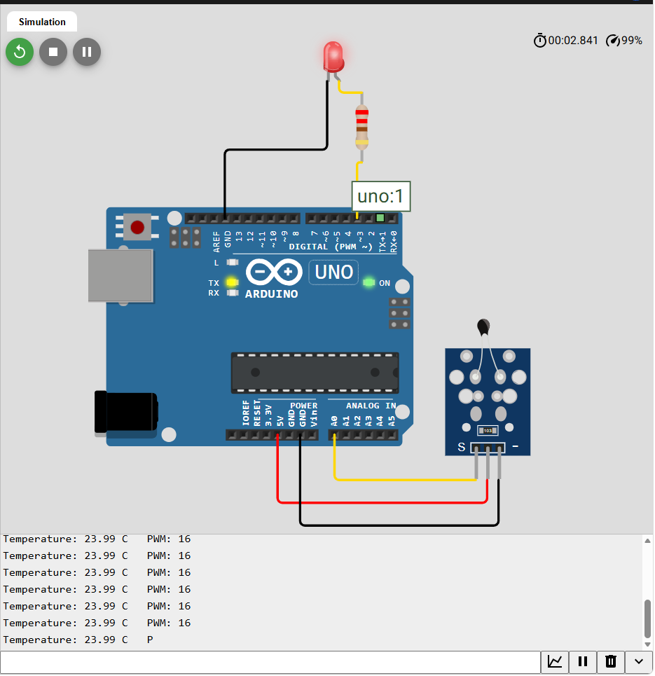
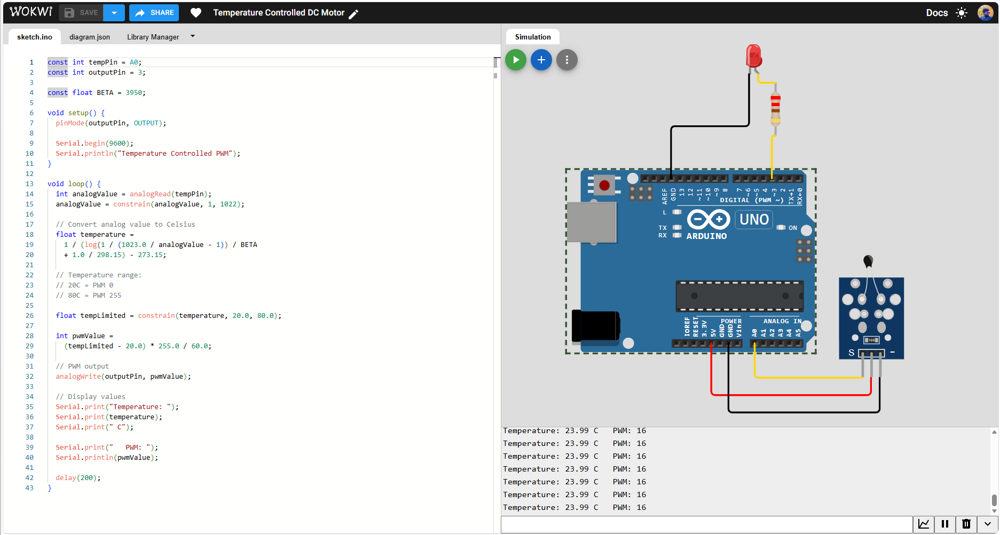

# 🌡️ Temperature Controlled DC Motor — Arduino UNO & Wokwi

  

> Temperature-dependent PWM control prototype using an Arduino UNO and an NTC thermistor. An LED visualizes the control signal in the Wokwi simulation.



## Overview

The Arduino reads an analog NTC temperature sensor on **A0**, calculates temperature in °C with a **BETA = 3950** thermistor model, and scales the PWM output on **D3** from 0 at 20 °C to 255 at 80 °C. The red LED becomes brighter as the temperature increases. The Serial Monitor prints both temperature and PWM every 200 ms.

**Important:** The screenshots show an LED as the output indicator, **not an actual DC motor**. The sketch demonstrates PWM command generation suitable for a *future* motor-driver stage; the Arduino pin must **not** be used to power a DC motor directly. This package does not represent a tested physical motor controller.

## Components

| Part | Quantity | Purpose |
|---|---:|---|
| Arduino UNO | 1 | Controller |
| Wokwi NTC temperature sensor module | 1 | Analog temperature input |
| Red LED | 1 | PWM output indication |
| 220 Ω resistor | 1 | Limits LED current |
| Wires | As needed | Circuit connections |

## Connections

| From | To |
|---|---|
| NTC VCC | Arduino 5V |
| NTC GND | Arduino GND |
| NTC OUT | Arduino A0 |
| Arduino D3 | 220 Ω resistor → LED anode (+) |
| LED cathode (−) | Arduino GND |

See [wiring guide](docs/WIRING.md).

## Control equation

The temperature is obtained from the NTC BETA model:

```text
T_C = 1 / ( ln(1 / (1023 / ADC - 1)) / 3950 + 1 / 298.15 ) - 273.15
```

The input is limited to the range **ADC = 1…1022** to avoid invalid logarithm inputs. The output is:

```text
T_limited = constrain(T_C, 20, 80)
PWM = integer( (T_limited - 20) * 255 / 60 )
```

| Temperature | Expected PWM | Approx. duty cycle |
|---:|---:|---:|
| ≤20 °C | 0 | 0% |
| 24 °C | 17 | 6.7% |
| 40 °C | 85 | 33.3% |
| 60 °C | 170 | 66.7% |
| ≥80 °C | 255 | 100% |

Rounding and sensor quantization can change individual readings slightly. In the original screenshot the monitor reports **23.99 °C, PWM 16**.

## Run the Wokwi project

1. Create a new [Arduino UNO simulation](https://wokwi.com/projects/new/arduino-uno).
2. Replace `sketch.ino` with the provided [source](sketch.ino).
3. Replace `diagram.json` with the provided [circuit definition](diagram.json).
4. Start the simulation and open the Serial Monitor.
5. Select the NTC sensor, adjust its temperature, and observe LED brightness and the printed PWM value.

The diagram is reconstructed from supplied screenshots and has **not been run in the Wokwi editor** as part of package creation. Verify the imported wiring in the simulator.

## Screenshots

| Wokwi circuit | Running simulation | Sketch + serial output |
|---|---|---|
|  |  |  |

## Project files

```text
Temperature-Controlled-DC-Motor-Arduino-Wokwi/
├── README.md
├── sketch.ino
├── diagram.json
├── src/
│   └── TemperatureControlledPWM.ino
├── docs/
│   ├── WIRING.md
│   ├── TESTING.md
│   └── screenshots/
│       ├── simulation-1.png
│       ├── simulation-2.png
│       └── simulation-3.png
├── GITHUB_UPLOAD.md
├── libraries.txt
└── LICENSE
```

## Resources

- [Wokwi NTC thermistor reference](https://docs.wokwi.com/parts/wokwi-ntc-temperature-sensor)
- [Arduino UNO simulation reference](https://docs.wokwi.com/parts/wokwi-arduino-uno)
- [Wokwi diagram format](https://docs.wokwi.com/diagram-format)

## License

MIT — see [LICENSE](LICENSE).
